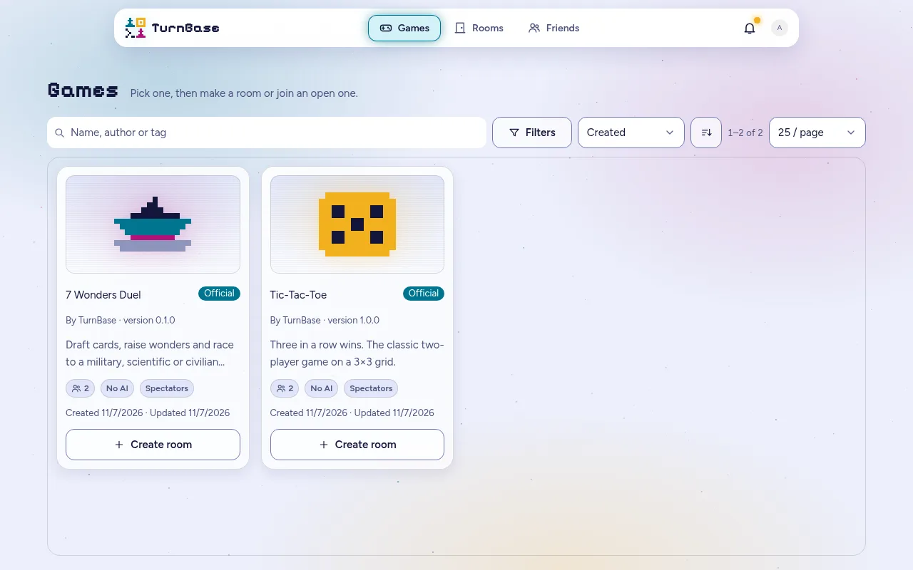
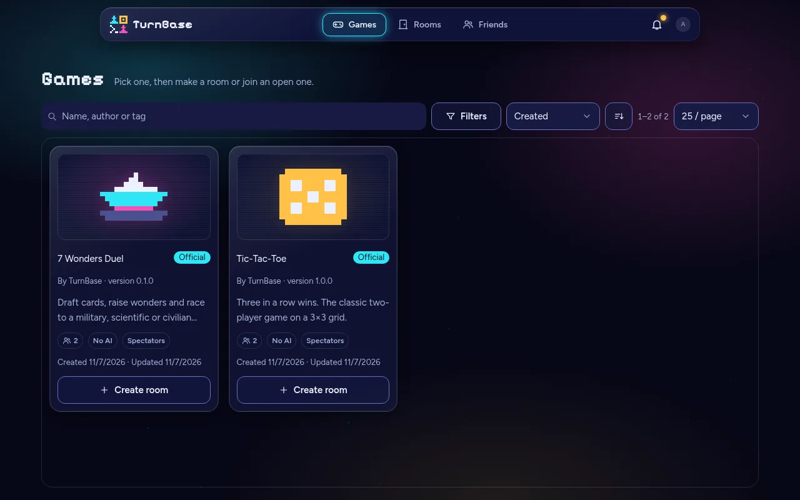
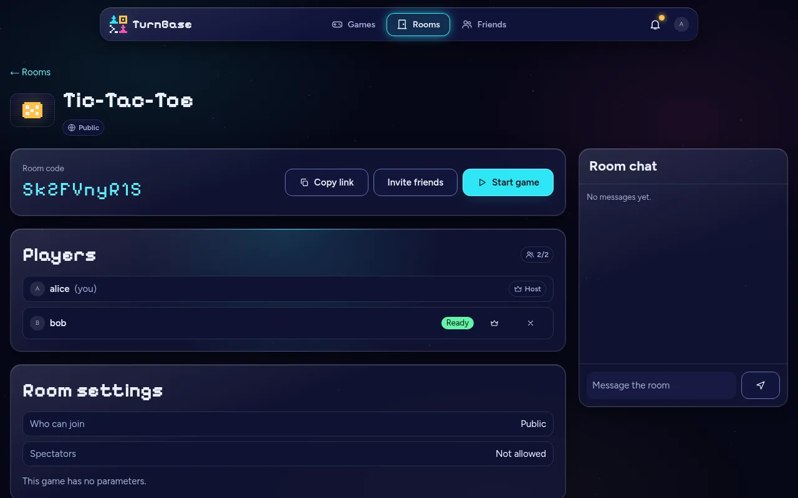
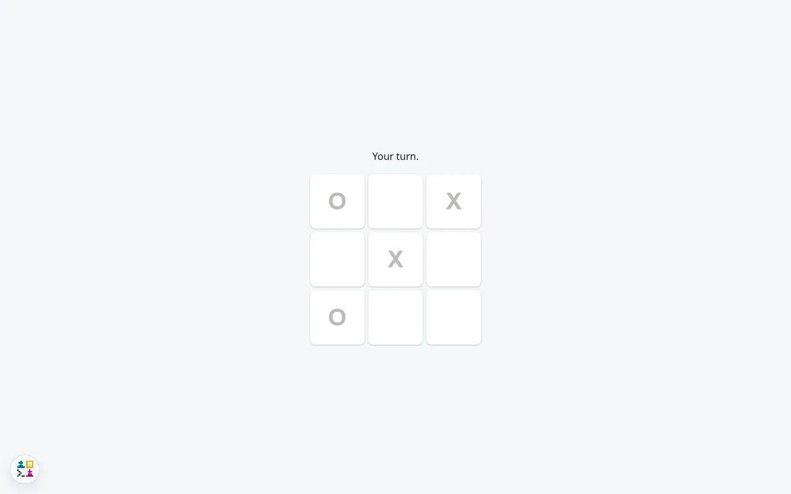
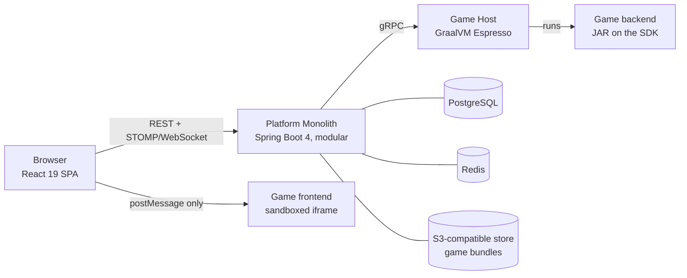

# TurnBase

**TurnBase is a platform for playing turn-based multiplayer games online: open a room, invite friends, take your turn.
It is also an SDK, so developers can write a game once and publish it to the catalog.**

It is a portfolio project about architecture, security and maintainability, and an experiment in building a whole
system with AI coding agents. The story of how it was built is told separately (`IMP-M21-07`), and every claim below
links to the place it can be checked.

[](docs/assets/catalog-light.webp)

| The catalog, dark | A room before the game starts | A game in play |
|---|---|---|
| [](docs/assets/catalog-dark.webp) | [](docs/assets/room-light.webp) | [](docs/assets/game-light.webp) |

The pictures were captured from the local stack below ([what each one shows](docs/assets/INDEX.md)); the game view
also exists in [dark](docs/assets/game-dark.webp).

## Architecture



The platform knows nothing about any game: game code runs in a GraalVM Espresso sandbox in a separate service, and
game UIs run in sandboxed iframes that can only talk to the shell by `postMessage`. Where each part lives:
[`ARCHITECTURE.md`](ARCHITECTURE.md); the end-to-end journeys: [`docs/specs/flows/`](docs/specs/flows/INDEX.md);
the decisions and their reasons: [22 ADRs](docs/decisions/INDEX.md).

## Repositories

| Repository | What it is |
|---|---|
| [`turnbase`](https://github.com/turnbase-platform/turnbase) | This repository: documentation, specifications, the build plan, and the submodules below |
| [`turnbase-platform`](turnbase-platform) | The Platform Monolith (Java 21, Spring Boot 4.1) |
| [`turnbase-game-host`](turnbase-game-host) | The Game Host: runs game backends in Espresso |
| [`turnbase-frontend`](turnbase-frontend) | The platform frontend (React 19, TypeScript, [Astryx](https://github.com/facebook/astryx)) |
| [`turnbase-sdk`](turnbase-sdk) | The public SDK: `TurnBaseGame`, the test harness, and the FE GDK |
| [`turnbase-common`](turnbase-common) | Internal shared library: the gRPC stubs |
| [`turnbase-game-tictactoe`](turnbase-game-tictactoe) | The first official game, and the template for yours |
| `turnbase-game-7wonders-duel` | The second official game. **Pending**: it names a commercial game, so it stays private until its publisher answers (see below) |

A recursive clone therefore fails on that last, private submodule. The rest of the clone is complete; to avoid the
error, initialise the submodules you need (`git submodule update --init turnbase-platform …`).

## Quickstart

Prerequisites: Docker with Compose v2, JDK 21, Node 22, `make`, `zip`. About ten minutes the first time.

```bash
git clone https://github.com/turnbase-platform/turnbase && cd turnbase
git submodule update --init turnbase-common turnbase-sdk turnbase-platform turnbase-game-host \
  turnbase-frontend turnbase-game-tictactoe

# The libraries the services compile against (until the first release tag is cut, they are built locally)
(cd turnbase-common && ./mvnw -q install -DskipTests)
(cd turnbase-sdk    && ./mvnw -q install -DskipTests)

# The two jars the images copy in, the game bundles the seeder uploads, then the three images
(cd turnbase-platform  && ./mvnw -q package -DskipTests)
(cd turnbase-game-host && ./mvnw -q package -DskipTests)
scripts/seed-bundles.sh
docker build -t turnbase/platform:dev  turnbase-platform
docker build -t turnbase/game-host:dev turnbase-game-host
docker build -t turnbase/frontend:dev  turnbase-frontend

# Secrets (dummy local-only values are copied for you), then the stack
cd turnbase-platform && make up
```

Open <http://turnbase.localhost:8080> and sign in as `alice` (or `bob`, `carol`, `dave`) with the password
`password`. Create a Tic-Tac-Toe room, join it from a second browser profile as `bob`, mark ready, and start.
Details and troubleshooting: [`local-environment.md`](docs/specs/deployment/local-environment.md) §5.

`scripts/seed-bundles.sh` builds both games, so it needs the 7 Wonders Duel checkout too. Without it, build the
Tic-Tac-Toe bundle alone (`./mvnw package`, `npm ci && npm run build`, `./scripts/package.sh` in
`turnbase-game-tictactoe`) and copy `target/seed/*.zip` into `target/seed-bundles/`.

## Write a game

A game is a Java 21 backend implementing `TurnBaseGame` plus any JavaScript-compiled frontend, packaged as a
bundle. The contract is in [`docs/specs/gdk-api/`](docs/specs/gdk-api/INDEX.md) and the manifest in
[`docs/specs/manifest/`](docs/specs/manifest/INDEX.md). Start from
[`turnbase-game-tictactoe`](turnbase-game-tictactoe), which depends only on the SDK and
ships tests that run against the harness with no platform at all.

The published coordinates ([ADR-0022](docs/decisions/0022-distribution-on-github.md)): Maven group
`io.github.turnbase-platform` (`turnbase-sdk`, `turnbase-harness`, …) from
`https://turnbase-platform.github.io/turnbase-sdk/maven/`, and the frontend GDK `@turnbase-platform/gdk` as a
tarball on the SDK's GitHub Release. No token or account is needed to read them. The first release, `v0.1.0`, has
not been cut yet, so today you build the SDK from its repository with `./mvnw install`.

## Status and roadmap

Phase 1, the implementation, is complete up to the public release: [`STATUS.md`](STATUS.md) says where it stands
and [`registry.md`](docs/implementation/registry.md) lists the open work. Next are M22, a cloud deployment
([ADR-0021](docs/decisions/0021-deployment-profiles.md)), and Phase C, the findings of the load tests
([`backlog.md`](docs/specs/backlog.md)). There is no live instance yet.

## Licence, credits, contributing

Apache-2.0, see [`LICENSE`](LICENSE). Fonts (Figtree, Pixelify Sans) are SIL OFL 1.1 and
[Astryx](https://github.com/facebook/astryx) is MIT.

*7 Wonders Duel* is a game by Antoine Bauza and Bruno Cathala, published by Repos Production. TurnBase's
implementation is an unofficial, independent project; it is not affiliated with or endorsed by them, and stays
private until the publisher has been asked and has answered.

Issues and security reports are welcome. Pull requests are not accepted for now.
